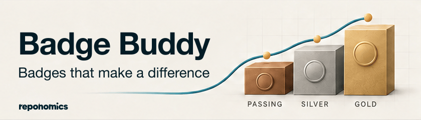

# Badge Buddy

<picture>
  <source media="(prefers-color-scheme: dark)" srcset="../../docs/assets/badge-buddy/badge-buddy-dark-840x240.png">
  
</picture>

Badge Buddy helps maintainers work through the [OpenSSF Best Practices](https://www.bestpractices.dev/) badge application, understand its criteria, and improve their projects. It also explains [OpenSSF Scorecard](https://scorecard.dev/) results, helps maintain GitHub Actions workflows, establishes useful test-coverage baselines, and configures static analysis.

> [!NOTE]
> Badge Buddy is an independent community project. It is not affiliated with or endorsed by the Open Source Security Foundation (OpenSSF) or The Linux Foundation.

## Get started

The command-line helpers require Python 3.11 or newer, available as `python3` on your PATH. They use only the Python standard library.

Add the marketplace and install the plugin in Claude Code:

```sh
claude plugin marketplace add reponomics/plugins
claude plugin install badge-buddy@reponomics
```

Ask for the help you need:

- “Help me fill out the OpenSSF Best Practices application.”
- “What does this Silver criterion mean for my project?”
- “Show me my current answers.”
- “Help me implement this missing practice.”

Badge Buddy covers Passing, Silver, Gold, and Security Baseline levels 1–3. You can ask questions, prepare answers, or work on the project as the conversation develops. For a new application, [register your project](https://www.bestpractices.dev/projects/new) on the badge website. Registration is not needed for explanations or implementation help, and you can ask to prepare answers before registering.

The current version primarily supports projects hosted on GitHub. Guidance about the criteria is useful on other forges, but synchronized assessments require a GitHub repository.

## Preparing answers

The application is yours, and you decide what to record and submit. The badge is self-reported, and Claude works with you in good faith: it takes your account of your project at your word, including things it cannot independently verify. It uses the official criterion text, the repository, and what you tell it to help draft answers and supply any required links or explanations. If something appears inconsistent with the facts or a criterion, it assumes clarification is needed, explains the discrepancy, and helps you work through it, allowing for context it may have missed.

A second agent reviews Claude's work before Claude presents its drafted answers or revisions to you. It checks whether Claude understood the criteria, wrote clearly, represented your account faithfully, and respected your instructions and control of the form. Your answers provide context for that review; the reviewer has no role in approving your application or vetting your honesty. You can skip the review or stop at any time. See the [peer review instructions](skills/ossf-bp-badges/references/peer-review.md).

For the Metal badges, a response and its effect on badge progress are distinct:

- Applicable `MUST` and `MUST NOT` requirements must be satisfied.
- An absent `SHOULD` practice is `Unmet`. It can still count toward the badge when accompanied by an adequate rationale.
- An absent `SUGGESTED` practice is also `Unmet`; answering it satisfies the badge's requirement to consider the practice.

`Met` means the practice is implemented. Unknown answers remain `?`, and `N/A` follows the criterion's applicability rules. You can save and submit an application with work still to do.

## Saving and reviewing progress

Claude saves answers in `.bestpractices.json` in private plugin storage by default. This lets you resume later without adding files to your repository. An existing repository assessment or an established storage preference takes precedence.

If you keep `.bestpractices.json` in your repository, Claude normally prepares changes in a temporary copy. You review those changes before they are written back, and Claude checks for intervening edits to the repository file. You can ask it to edit that file directly instead. Temporary work is applied or discarded with you at session end. Tracking the file in Git is your choice.

Ask to preview your answers to open a local board. It shows the official criteria, your answers and justifications, and evidence links. Each board covers one badge section. You can read all criteria together or choose a response category such as Unmet. A table of contents helps you move through the list.

The board refreshes as Claude updates your assessment. Reading or navigating it does not change an answer. Discuss revisions in the conversation. During an interactive revision, Claude updates the justification first and keeps the response unchanged while you review the wording. After you approve it, Claude updates the response. Initial drafts can include both together.

## Submitting answers

Claude offers the available submission paths and follows your preference:

- **Proposal URLs:** open your proposed answers in the official edit form, with changes highlighted for review. Nothing is saved by opening a link.
- **A repository `.bestpractices.json`:** commit the exported file so the badge site can read it as automated-tool input. The site fills blanks and flags differences for review without overwriting answers a person has already recorded.
- **A console fill script:** paste the generated script into your browser's console on the edit page. This is useful for wording-only edits, long answers, or a selected group of fields. The script fills the form without saving it.

You review and save the website form. Claude may help with login or saving only when you explicitly ask it to perform that action. The plugin's controller does not authenticate or write to the badge site. See the [submission guide](skills/ossf-bp-badges/references/application.md#website-transfers) for details.

## OpenSSF Scorecard

Ask **“Explain my Scorecard findings”**, **“Set up a Scorecard badge”**, or **“Fix the unpinned actions reported by Scorecard.”** The [Scorecard skill](skills/ossf-scorecard/SKILL.md) reads published results, investigates findings, and helps implement improvements. It can configure the official Scorecard Action when you want to publish results. An existing public result may already support a badge without adding an Action.

Scorecard work needs no local Scorecard installation or Best Practices registration. The API returns an existing published result; fetching it does not start a scan. After changes reach your remote repository, Claude checks for a newer published result before reporting an effect on the score. It reports any limits on coverage or comparison.

Implementation and publication guidance covers public GitHub repositories. The controller can also read existing GitLab API results, including subgroup repositories, and import upstream Scorecard JSON from a file or standard input. Those imports do not publish results. See the [publication guide](skills/ossf-scorecard/references/action-publication.md) and [diagnostic options](skills/ossf-scorecard/references/authentication-and-results.md#optional-upstream-cli-diagnostics).

## GitHub workflow maintenance

Ask **“Audit my GitHub Actions workflows”**, **“Pin my actions to full SHAs with version comments”**, or **“Move workflow writes to the jobs that need them.”** The [workflow maintenance skill](skills/github-workflow-maintenance/SKILL.md) works independently of Scorecard and badge registration.

It reviews action versions and pins, job permissions, reusable workflows, and existing Dependabot or Renovate coverage. It can implement the changes you request and explain their effects. Repository settings, such as SHA enforcement or action allowlists, are proposed separately so you can assess their compatibility and maintenance cost. The skill reports what it checked and what remains unverified.

## Test coverage

Ask **“Help me get a coverage badge”**, **“Establish a coverage baseline”**, or **“Find worthwhile tests for our uncovered code.”** The [coverage baseline skill](skills/coverage-baseline/SKILL.md) helps you measure your tests, publish a report, and add a badge that lets visitors see how much of your code the tests exercise. Getting that badge working is a useful first step toward better testing.

The guidance starts with your existing test runner, includes untested source files, and explains the coverage metric your tool measures. Alongside Python and JavaScript examples, a [language guide](skills/coverage-baseline/references/languages.md) covers Go, Rust, Java/Kotlin, .NET, C/C++, Swift, Ruby, and PHP. A Python GitHub Actions template demonstrates running tests and sending the report to Codecov; other languages can use the same reporting and badge steps with their own test commands and report formats. Local HTML reports and CI artifacts are also supported.

The badge links to the report for the intended branch so visitors can explore the result. The same measurements help with OpenSSF's statement- and branch-coverage criteria, and the skill explains which measurements each criterion needs.

The [coverage-tool license guide](skills/coverage-baseline/references/licenses.md) lists license names and OSI approval status for the recommended tools, separately from Codecov's hosted service.

## Static analysis

Ask **“Help me add a code-analysis badge”**, **“Configure CodeQL”**, **“Set up Bandit for our Python code”**, or **“Should we use Snyk Code or Snyk Open Source?”** The [static analysis skill](skills/static-analysis/SKILL.md) helps choose a tool that fits your project, get the first scan running, and add a badge linked to its results. It explains source-code checks and dependency vulnerability checks in plain language.

It covers CodeQL default and advanced setup, a Python workflow example, Bandit configuration, Snyk's product choices, and [practical starting tools for other languages](skills/static-analysis/references/languages.md). The skill helps you work through the first findings without getting overwhelmed. Coverage and static-analysis work need no OpenSSF registration.

A workflow badge shows whether the analysis job passed, while the linked results show what it found. The skill explains that distinction when adding the badge and helps turn findings into fixes. Scan history and those fixes also support the relevant OpenSSF static-analysis criteria.

The [analyzer license guide](skills/static-analysis/references/licenses.md) lists license names and OSI approval status, including which parts of CodeQL and Snyk are open source and which use separate product terms.

## Development

From the repository root:

```bash
make setup
make check
make plugin-validate
```

The runtime uses only the Python standard library. The root Makefile runs all plugin and maintenance tests, then compiles the Python sources. Plugin validation requires the Claude Code CLI. See the repository [README](../../README.md) for the layout.

The badge controller provides these commands:

| Command                           | Purpose                                                                                               |
| --------------------------------- | ----------------------------------------------------------------------------------------------------- |
| `status`                          | Synchronize and report registration, differences, counts, and answers.                                |
| `apply --section <section>`       | Validate and record updates for a badge section.                                                      |
| `review --section <section>`      | Open the section's board; add `--view all` to show all criteria.                                      |
| `export --output <path>`          | Write the assessment to an explicit path.                                                             |
| `propose --section <section>`     | Generate official proposal URLs.                                                                      |
| `fill-script --section <section>` | Generate a script for wording changes; use `--criteria` for a subset or `--all` for the full section. |

For direct controller use, provide the repository and private data paths. When using a repository assessment or a temporary copy, select the existing working file explicitly:

```bash
venv/bin/python plugins/badge-buddy/scripts/ossf.py \
  --repo /path/to/project \
  --data-dir /path/to/private/plugin-data \
  --assessment-file /tmp/assessment-session.json \
  review --view all --section passing
```

`--assessment-file` must point to an existing flat JSON object. All operations use that file directly. Omit it to use private storage when the repository has no assessment file. Run `status` online once at the start of each Claude Code session to verify the repository/project association and reconcile saved website answers with local answers. Subsequent edits, previews, and transfers use that saved public snapshot without fetching again. Rerun online status if the repository or project ID changes. Run `status` again after saving website changes, or use `status --offline` to inspect local progress. Public synchronization uses GET requests and needs no GitHub credentials; `status --project-id <id>` selects a known badge entry. See the [application guide](skills/ossf-bp-badges/references/application.md#start-or-resume) for storage and synchronization details.

The Scorecard controller supports `fetch --repo owner/repo --output <path>`, `explain --input <path>`, and `diff --before <path> --after <path>`. It preserves published results and compares them without recomputing the upstream score.

The bundled [BadgeApp questionnaire](assets/examples/badgeapp/README.md) is a dated worked example with provenance and licensing information. Its answers describe BadgeApp and are not copied into another project's assessment.

For catalog updates, `make refresh-upstream BADGE_REPO=/path/to/clone` downloads the public application pages and verifies a candidate catalog before replacing the bundled one. Ordinary plugin use reads the bundled assets. See [criteria maintenance](../../docs/criteria-maintenance.md) for the full procedure.

---

Badge Buddy includes material from the OpenSSF Best Practices badge contributors and the OpenSSF Security Baseline and Scorecard projects. See [third-party notices](../../THIRD_PARTY_NOTICES.md) for attribution, sources, and licensing information.

OpenSSF® is a trademark of The Linux Foundation. “OpenSSF Best Practices” refers to the badge program operated at [bestpractices.dev](https://www.bestpractices.dev/), and “OpenSSF Scorecard” to the project at [scorecard.dev](https://scorecard.dev/). Badge Buddy is an independent tool for working with those programs.
