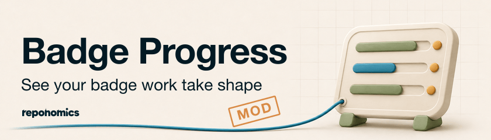

# Badge Progress

<picture>
  <source media="(prefers-color-scheme: dark)" srcset="../../docs/assets/badge-progress/badge-progress-dark-840x240.png">
  
</picture>

Badge Progress shows how far along your OpenSSF Best Practices application is while you work on it with [Badge Buddy](../badge-buddy/README.md). It adds a pane to Claude Code with the answer counts for each badge section, and a progress bar above the prompt while Claude records answers.

It is a mod: a plugin that changes Claude Code's interface through function hooks rather than adding skills. It reads the results of the Badge Buddy commands Claude already runs, so it needs no setup and makes no network requests of its own.

## Get started

```sh
claude plugin marketplace add reponomics/plugins
claude plugin install badge-buddy@reponomics
claude plugin install badge-progress@reponomics
```

Start or resume badge work as usual, for example "Help me with the OpenSSF Best Practices Passing badge." The pane opens the first time Claude checks the application's status. Open it again at any time with `/badge-progress`.

## What it shows

- **The pane** lists each started section (Passing, Silver, Gold, Baseline 1–3) with a bar of answered criteria, the Met / Unmet / N/A / `?` breakdown, answers still missing a required justification or URL, and any differences from the saved website entry that need resolving.
- **The progress band** appears above the prompt while a turn is recording answers for a section, with the running count and how many were answered during the turn.
- **A short notice** at the end of that turn summarizes the change.

"Answered" means any status other than `?`, as Badge Buddy counts it. The counts describe what is recorded in the working assessment. They are not a badge percentage, and they do not mean the website entry has been saved.

The last counts are kept per project directory, so the pane shows them at the start of the next session until Claude refreshes the status.

## Development

```sh
claude plugin validate plugins/badge-progress
claude plugin test plugins/badge-progress
```
